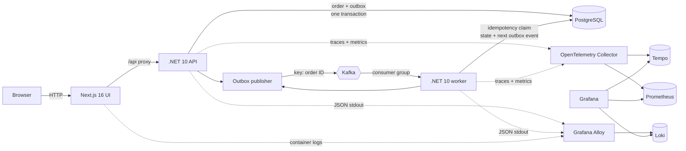
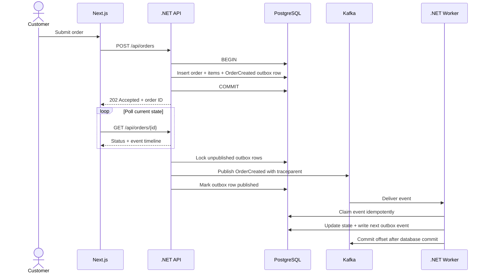

# OrderFlow

OrderFlow is an event-driven order-processing lab for learning modern full-stack development, reliable messaging, and production observability. A Next.js interface lets you submit an order and watch it move through a .NET 10 API, PostgreSQL transactional outbox, Kafka, and a background worker in real time.

## What is included

- Next.js 16 App Router frontend with a runtime API proxy
- .NET 10 ASP.NET Core API and background worker
- PostgreSQL schema and seed products
- Kafka running in single-node KRaft mode
- Transactional outbox and idempotent consumer foundations
- OpenTelemetry Collector, Prometheus, Grafana, Tempo, Loki, and Alloy
- Provisioned Grafana data sources, dashboard, and Prometheus alerts
- Product, architecture, operations, and observability documentation

## Quick start

Requirements: Docker Engine with Docker Compose v2 and at least 6 GB of memory available to Docker.

```bash
cp .env.example .env
docker compose up --build -d
docker compose ps
```

Open:

- Application: <http://localhost:8088>
- API health: <http://127.0.0.1:3008/health/ready>
- Grafana: <http://localhost:3009> (`admin` / the value of `GRAFANA_ADMIN_PASSWORD`)
- Prometheus: <http://localhost:9098>
- Kafka UI: <http://localhost:8089>

Create an order from the frontend, then inspect its trace, application metrics, Kafka events, and structured logs.

## Architecture

OrderFlow separates the synchronous customer request from asynchronous order processing. PostgreSQL is the source of truth; Kafka transports lifecycle events; OpenTelemetry connects each request, database operation, and message into one observable story.



### Order event flow



### Why it is designed this way

| Pattern | Purpose |
|---|---|
| Transactional outbox | Commits the business change and intent to publish in the same PostgreSQL transaction. |
| At-least-once delivery | Prefers safe redelivery over silently losing an event. |
| Idempotent consumer | Uses `(event_id, consumer_name)` to make a duplicate delivery a no-op. |
| Order ID as Kafka key | Keeps all transitions for one order in the same partition and therefore ordered. |
| Manual offset commit | Commits Kafka progress only after the database transaction succeeds. |
| W3C trace propagation | Carries `traceparent` through the outbox and Kafka headers so HTTP and message spans stay correlated. |

### Observability paths

| Signal | Emitted by | Route | Answers |
|---|---|---|---|
| Metrics | ASP.NET Core, .NET runtime, application `Meter` instruments | OTLP → Collector → Prometheus → Grafana | Is the system healthy, fast, and keeping up? |
| Traces | ASP.NET Core, Npgsql, custom Kafka `ActivitySource` spans | OTLP → Collector → Tempo → Grafana | Where did this order spend time or fail? |
| Logs | Structured `ILogger` JSON and container stdout | Docker → Alloy → Loki → Grafana | What exactly happened for this event or trace? |

The local topology is deliberately single-node and optimized for learning rather than high availability. See [Architecture and event flow](docs/architecture.md) for topic ownership, failure behavior, and scaling guidance.

Stop the environment while keeping data:

```bash
docker compose down
```

Remove the environment and its local Docker volumes:

```bash
docker compose down --volumes
```

## Useful commands

```bash
make help
make up
make status
make logs
make smoke
make config
make down
```

## Repository map

```text
apps/
  api/                 .NET 10 HTTP API
  frontend/            Next.js 16 App Router UI and API proxy
  shared/              Shared telemetry, Kafka, and outbox infrastructure
  worker/              .NET 10 Kafka consumer and order workflow
database/              PostgreSQL initialization
docker/kafka/          Kafka topic initialization
docs/                  Product and engineering documentation
observability/         Collector, metrics, traces, logs, dashboards, alerts
compose.yaml           Complete local environment
```

## Documentation

- [Product requirements](docs/product-requirements.md)
- [Architecture and event flow](docs/architecture.md)
- [Observability, SLI, SLO, and SLA](docs/observability.md)
- [Development and operations guide](docs/development.md)
- [.NET observability and messaging learning guide](docs/dotnet-learning-guide.md)

This environment is deliberately educational. The single-node databases and brokers are not a production deployment topology.

Published host ports are configurable in `.env`; internal container ports remain unchanged.
